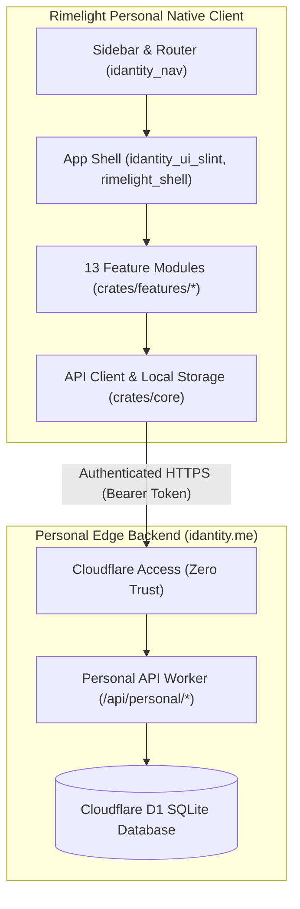

# Rimelight Personal — Project Specification

> **Status:** Single Source of Truth & Authoritative Technical Manual  
> **Project Name:** Rimelight Personal (formerly `idantity-native`)  
> **Primary Technology:** Rust 2024 (1.100.0) | Slint | Cloudflare D1 + Access | WebAssembly  
> **Backend Host:** `idantity.me/api/personal` (Cloudflare Worker + D1 Database)

---

## 1. High-Level Vision & Scope

**Rimelight Personal** is a native multiplatform personal productivity suite and life operating system built in Rust and Slint. It is the official native replacement for the legacy web app `personal.idantity.me`.

### Key Architectural Pillars

1. **Native Performance & Fluidity:** Replaces client-side web rendering with a high-performance native desktop client (Windows, macOS, Linux) and WebAssembly target powered by **Slint**.
2. **Unified Life Dashboard:** Aggregates 13 distinct life domains (tasks, calendar, finances, notes, health, housing, habits, and media) into a unified personal workstation.
3. **Edge Database & Serverless Sync:** Connects to Cloudflare D1 via the personal backend at `idantity.me/api/personal`, authenticated securely through Cloudflare Access.
4. **Shared Rimelight Design Tokens:** Employs `rimelight_design` tokens and `rimelight_shell` layouts to maintain visual harmony with Rimelight Space and the web ecosystem.

---

## 2. Technical Architecture



### Core Technologies
- **Rust Toolchain:** Pinned to `1.100.0` via `rust-toolchain.toml` (2024 edition).
- **UI Framework:** Slint 1.18.1 compiled via `crates/idantity_ui_slint`.
- **Backend Host:** Hosted within `idantity.me` worker at `/api/personal/*` querying Cloudflare D1 SQLite database with Drizzle ORM migrations.
- **Authentication:** Cloudflare Access policy validation (`POLICY_AUD` and secret tokens).

---

## 3. Comprehensive Feature Catalog (13 Core Modules)

### 3.1 Overview (`/`)
* **Unified Command Center:** Dynamic hero dashboard bringing all active modules together.
* **Quick Task Input:** Instant task capture submitting to the daily todo queue.
* **Daily Agenda:** Filtered list of tasks due today with one-click completion toggles.
* **Financial Summary:** Liquid balances, monthly fixed bills total, active subscription counts, and debt ledger ("I owe" / "Owed to me").
* **Module Shortcuts:** Fast-action widgets for active fasting timers, workout logs, habits, and pinned notes.

### 3.2 Todos (`/todos`)
* **Task Management:** Full task creation with title, priority (low, medium, high, urgent), categories, and scheduled due dates.
* **Filter Views:** Dedicated views for Today, Upcoming, Completed, and Categorized tasks.
* **Batch Operations:** Multi-select toolbar supporting batch completion and deletion.

### 3.3 Focus (`/focus`)
* **Productivity Timer:** Pomodoro and interval focus timer with configurable work/break cycles.
* **Ambient Audio:** Integrated background ambient noise player for deep work sessions.

### 3.4 Notes (`/notes`)
* **Organization:** Tabbed categorization (Active, Archived, Trash) with real-time text and tag search.
* **Rich Editor:** Debounced autosave, color coding, tag chip management, and quick note modals.
* **Pinned Notes:** Dedicated top tier for frequently referenced documentation.

### 3.5 Habits (`/habits`)
* **Calendar Mode:** 12-month visual grid tracking completion days across custom categories.
* **Streaks Mode:** 52-week activity heatmap (365 days) displaying current streaks, historical best streaks, and annual completion percentage.

### 3.6 Watchlist (`/watchlist`)
* **Media Catalog:** Tracking for Movies, TV Shows, Anime, and Books.
* **Statuses:** Categorized into Want to Watch/Read, In Progress, Completed, and Dropped.

### 3.7 Music (`/music`)
* **Audio Player:** Album drop zone, playlist queue, local audio playback, and metadata tags.

### 3.8 Notebooks (`/notebooks`)
* **Hierarchical Documentation:** Structured multi-page notebooks divided into volumes and chapters for deep writing.

### 3.9 Projects (`/projects`)
* **Kanban Boards:** Customizable columns, drag-and-drop card movements, task checklists, and sprint tracking.

### 3.10 Finances (`/finances`)
* **Accounting:** Multi-account balances (checking, savings, investments), transaction logs, income vs expenses breakdown.
* **Currency Support:** Primary tracking in BRL with automatic exchange rate conversion via Frankfurter API.
* **Recurring Obligations:** Scheduled bill reminders and active subscription renewals.

### 3.11 Housing (`/housing`)
* **Household Inventory:** Grocery lists, out-of-stock alerts, household supplies tracking.
* **Home Maintenance:** Recurring chore schedules, appliance warranties, and home repair logs.

### 3.12 Health (`/health`)
* **Biometrics:** Weight, body fat, and physical measurement logging over time with progress charts.
* **Intermittent Fasting:** Live fasting timer tracking hours elapsed and target fasting windows.
* **Workouts:** Routine templates and exercise set/rep/weight logging.

### 3.13 Inbox & Storage (`/inbox`, `/storage`)
* **Unified Communications:** Cloudflare Email Routing integration directing incoming emails (`daniel@`, `hello@`, `admin@`) into a triage inbox.
* **Cloud Storage Explorer:** File and document management with category tagging and file upload pipelines.

---

## 4. Workspace Layout & Crates

```
rimelight-personal/
├── apps/
│   ├── desktop/                 # Native Windows/desktop Slint entry point
│   └── web/                     # WebAssembly entry point
├── crates/
│   ├── core/                    # API client, SQLite offline cache, and domain types
│   ├── idantity_nav/            # Navigation model, route definitions, and sidebar state
│   ├── idantity_ui_slint/       # Slint compilation target and widget glue
│   └── features/                # 14 modular domain crates
│       ├── overview/            # Dashboard widgets
│       ├── todos/               # Task management logic
│       ├── focus/               # Timer and soundscapes
│       ├── notes/               # Notes editor and storage
│       ├── habits/              # Habit tracker and heatmaps
│       ├── watchlist/           # Media tracker
│       ├── music/               # Audio playback
│       ├── notebooks/           # Notebook document hierarchy
│       ├── projects/            # Kanban boards
│       ├── finances/            # Financial ledgers and rates
│       ├── housing/             # Chores and groceries
│       ├── health/              # Fasting and workouts
│       ├── inbox/               # Email triage
│       └── storage/             # Cloud storage client
├── AGENTS.md                    # Agent operating rules & "build once" constraint
├── README.md                    # Local development quickstart
├── PROJECT.md                   # Comprehensive technical manual & feature specs (this file)
└── PLAN.md                      # Feature porting progress matrix & decision log
```

---

## 5. Development Standards & Conventions

1. **Slint Isolation:** Slint markup compiles exclusively inside `crates/idantity_ui_slint` and feature crates. Components must adhere to tokens in `rimelight_design`.
2. **Build Discipline:** Adhere strictly to the "build ONCE at the end" rule. Write Rust feature logic across crates in batches before initiating cargo compilation.
3. **Zero Hardcoded Personal Secrets:** Email addresses and personal identities must be sourced dynamically from authenticated session tokens (`locals.user.email`), never hardcoded in client source.
