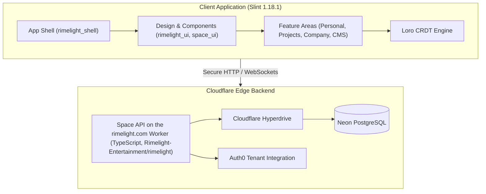

# Rimelight Space — Project Specification

> **Status:** Single Source of Truth & Authoritative Technical Manual  
> **Type:** Internal Proprietary Enterprise Resource Planning (ERP) Platform  
> **Primary Technology:** Rust 2024 | Slint 1.18.1 | TypeScript API on the rimelight.com Worker | Loro CRDT  
> **Target Scale:** 250+ enterprise users, multiplatform native deployment.

---

## 1. High-Level Vision & Scope

**Rimelight Space** is the proprietary, all-in-one Enterprise Resource Planning (ERP) and operational workstation for Rimelight Entertainment. It provides a cohesive native workspace unifying company management, creative production, game development workflows, player support, and personal productivity into a single high-performance Rust application.

### Key Pillars

1. **Native Multiplatform Performance:** Built in Rust with **Slint 1.18.1**, compiling to high-performance native desktop clients (Windows, macOS, Linux) and mobile (Android, iOS), alongside a WebAssembly target.
2. **Real-Time Collaboration (Loro CRDT):** Document, project, and block editing feature character-level real-time co-editing, live cursor presence, and offline resilience powered by **Loro CRDT**.
3. **Single Source of Truth for Franchise Content:** Rimelight Space is the canonical authoring studio for all CMS content, wiki pages, screenplays, and documentation. Published content feeds directly to `rimelight.com`.
4. **Unified Operations:** Eliminates fragmented third-party SaaS tools by unifying HR, finance, supply chain, asset tracking, project management, customer relationships, and player support into one unified database and UI.

---

## 2. System Architecture



### Core Technologies
- **Language & Toolchain:** Rust 2024 Edition, pinned compiler toolchain (`rust-toolchain.toml`).
- **UI Framework:** Slint 1.18.1 (`slint`, `slint-build`, `i-slint-backend-testing`).
- **Design Tokens:** `rimelight_design` (`tokens.json` compiled to `ui/tokens.slint` and Rust constants).
- **Component Suite:** `rimelight_ui`, `rimelight_ui_kit`, `space_ui`, `rimelight_shell`.
- **Media Engine:** `rimelight_media` and `rimelight_picture` (integrated video, audio, image decoders, and WebP pipeline).
- **Backend Infrastructure:** The Space API is TypeScript on the rimelight.com Worker (`apps/rimelight.com/src/space/` in `Rimelight-Entertainment/rimelight`; decision 0041 removed the Rust Worker), using Cloudflare Hyperdrive for pooled PostgreSQL connections and Auth0 enterprise identity abstraction.

---

## 3. Product Modules & Areas

### 3.1 Personal Workplace & Communication
- **Personal Tasks & Todos:** Focus modes, task queues, daily schedules, and personal calendar.
- **Unified Chat:** Real-time team messaging, channels, direct messages, and contextual thread discussions.
- **Personal Notes & Scratchpads:** Quick-capture rich text notes with markdown rendering.

### 3.2 Projects & Issue Tracking
- **Issue Tracking:** Kanban boards, sprint backlogs, task assignments, and priority triage.
- **Milestones & Slices:** Vertical slice tracking with verifiable criteria and gate validation.
- **Game Production Workflows:** Asset pipeline tracking linking Unreal Engine and game assets.

### 3.3 Company, People & HR
- **Directory & Org Chart:** Team rosters, departmental structures, reporting lines, and access roles.
- **Time Off & Leave:** Vacation tracking, public holiday calendars, and approval workflows.
- **Recruitment & Onboarding:** Candidate tracking, onboarding checklists, and role provisioning.

### 3.4 Finance & Operations
- **Corporate Accounting:** Expense tracking, invoice generation, balance ledgers, and transaction audit trails.
- **Hardware & Asset Inventory:** Machine allocation, licenses, devkit assignments, and office procurement.

### 3.5 Player Support & Community Operations
- **Customer CRM:** Unified support ticket inbox, game account lookups, and player feedback.
- **Moderation Tools:** In-game audit log inspection and player dispute resolution.

### 3.6 CMS Block Editor Studio
*Canonical authoring tool for wiki, docs, blog, and screenplay content.*
- **Co-Editing:** Multi-user character-level collaborative editing with cursors and presence via Loro CRDT.
- **Adaptive Layout:** Inline WYSIWYG editing with side inspector panel (or bottom sheet on mobile).
- **Block Catalogue:**
  - *Text Primitives:* Paragraph, Section (nesting 2–6 deep), Callout (with status variants), Quote, Code (with language highlighting and line numbers).
  - *Lists:* Unordered List, Ordered List, List Item (with tab-indent nesting).
  - *Media & Data:* Image (with caption, sizing, alt text), Table (cell editing, border toggle), Divider, File Tree (interactive directory hierarchy).
  - *Interactive Elements:* Tabs & Tab Item, Steps & Step Item, Cards & Card (with badges, icons, links).
  - *Screenplay Blocks:* Scene heading, action, character, dialogue, parenthetical, transition, and shot blocks for franchise narrative writing.

---

## 4. Workspace & Repository Structure

```
rimelight-space/
├── apps/
│   └── desktop/                 # Desktop entry application (Windows, macOS, Linux)
├── areas/                       # Domain functional areas
│   ├── company/                 # Company directory, organizational units, and HR
│   ├── management/              # Executive dashboards, operations, and policy
│   ├── personal/                # Personal tasks, schedule, and workspace
│   └── projects/                # Issue tracking, kanban, and sprint boards
├── backend/                     # Rust helper crates: Postgres migration SQL (db) and a jobs placeholder; the API is on rimelight.com
├── crates/                      # Internal Rust modules
│   ├── space_ui/                # Slint markup, themes, and UI widgets
│   ├── space_page_kit/          # Standard page layout shells and navigation
│   └── space_core/              # Domain models, local storage, and API clients
├── release/                     # Velopack installer configurations and release scripts
├── xtask/                       # Monorepo automation tasks (gates, formatting, checks)
├── AGENTS.md                    # Agent instructions: strict "build once" rule and gates
├── README.md                    # Local development quickstart and build commands
├── PROJECT.md                   # Comprehensive technical manual & architecture (this file)
└── PLAN.md                      # Vertical slice implementation tracker and decision log
```

---

## 5. Development Conventions & Standards

### 5.1 Rust & Slint Rules
- **No Direct Std-Widgets:** Feature code must import components from `rimelight_ui` / `space_ui`, never standard Slint widgets directly.
- **Design Token Strictness:** All colors, typography, and spacing must reference `rimelight_design` tokens. Hardcoded pixel or hex values are prohibited.
- **Strict Single-Build Workflow:** Developers and AI assistants must batch code changes across crates and execute only a single compilation and test run at the conclusion of a work batch to prevent disk thrashing.

### 5.2 Naming Conventions
- **Crates:** Prefixed with `space_*` for internal space crates.
- **Slint Files:** `PascalCase.slint` (e.g., `IssueCard.slint`, `ProjectBoard.slint`).
- **Rust Modules:** Standard `snake_case`.
