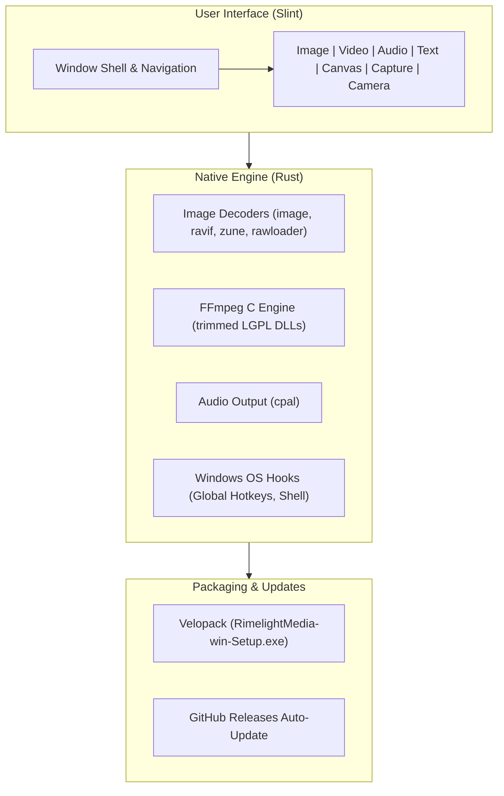

# Rimelight Media — Project Specification

> **Status:** Single Source of Truth & Authoritative Technical Manual  
> **Type:** High-Performance Unified Media Application for Windows  
> **Primary Technology:** Rust 2024 | Slint | Trimmed LGPL FFmpeg | Velopack  
> **Footprint:** ~30 MB installed, zero runtime dependencies.

---

## 1. High-Level Vision & Scope

**Rimelight Media** is a compact, ultra-fast Windows utility and media player designed to replace bloated default and third-party desktop tools. It combines viewing, playing, markup, editing, screen capture, camera capture, and text editing into a single lightweight ~30 MB native binary.

### Applications Replaced

| Windows / 3rd-Party App | Rimelight Media Replacement |
|---|---|
| **Photos / Image Glass** | Image Viewer & Markup Studio |
| **Media Player / VLC / Movies & TV** | High-Efficiency Video & Audio Player |
| **Notepad / Notepad++** | Text Editor & Markdown/JSON Viewer |
| **Snipping Tool** | Global Screen Snip (`Win+Shift+S`) & Video Screen Recorder |
| **Camera** | Webcam Photo & Video Capture |
| **Sound Recorder** | Microphone Voice & Audio Recorder |
| **Paint / MS Paint 3D** | Vector & Raster Canvas Studio |

---

## 2. Technical Architecture

### Architecture Highlights
- **Engine & GUI:** Rust 2024 paired with **Slint** for low-memory, GPU-accelerated interface rendering.
- **FFmpeg Integration:** Custom trimmed LGPL FFmpeg build (approx. 17 MB DLLs) managed via `tools/get-ffmpeg.ps1`. Decodes H.264, HEVC, AV1, VP9, MP3, FLAC, AAC, WAV, OGG, Opus without requiring external codecs.
- **Installer & Auto-Updates:** Packaged with **Velopack**. Installs per-user (`%LOCALAPPDATA%\RimelightMedia`) without UAC prompts and automatically updates in the background.

---

## 3. Comprehensive Feature Catalog

### 3.1 Pictures (Image Viewer & Editor)
- **Format Support:** PNG, JPEG, WebP, SVG, GIF, BMP, ICO, HEIC/HEIF, AVIF, and Camera RAW (DNG, CR2/CR3, NEF, ARW, RAF, ORF, RW2).
- **Viewing Modes:** Dynamic zoom/pan, folder browsing, multi-file selection side-by-side comparison grid.
- **Animation Controls:** Frame stepping, playback speed, and pause for animated GIF and WebP.
- **Image Editing & Markup:**
  - Crop, rotate (90° steps and freeform), horizontal/vertical flip, aspect-ratio scaling.
  - Vector markup: Pen, highlighter, arrows, lines, rectangles, ellipses, filled polygons, text annotations, eyedropper, and paint bucket.
  - Image insertion: Paste clipboard images directly into the active frame.

### 3.2 Canvas (Paint Replacement)
- **Workspace:** Blank drawing canvas with presets (window match, 1080p, A4, custom size; opaque white or transparent).
- **Tools:** Rectangle select (cut, copy, crop, delete), freehand drawing, stamp tools, color pickers, and undo/redo history.
- **Storage:** Automatically exports to `Pictures\Canvas`.

### 3.3 Video & Music Player
- **Containers & Codecs:** MP4, MKV, WebM, MOV, AVI, MPEG; audio: MP3, FLAC, WAV, OGG, Opus, M4A.
- **Playback Capabilities:** Subtitle support (embedded text/bitmap subtitles, external SRT, VTT, ASS) with size and timing offset adjustment. Variable playback speeds (0.25x to 3.0x).
- **Waveform Seek Bar:** Visual audio waveform timeline with drag handles for in-app clip trimming.
- **Network Streaming:** DLNA casting support to smart TVs and networked speakers.

### 3.4 Text (Notepad Replacement)
- **Supported Formats:** TXT, Markdown (`.md`), JSON, TOML, YAML, INI, CSV, XML, and log files.
- **Specialized Modes:**
  - Markdown: Raw edit mode, live preview mode, and split view.
  - JSON: Tree view inspector, formatter, minifier, key sorter, and syntax validator with line/column pointers.
- **Encoding & Line Endings:** Retains file encoding (UTF-8, UTF-8 BOM, UTF-16) and line endings (CRLF vs LF).

### 3.5 Screen Capture & Recording
- **Global Hotkeys:** `Print Screen` or `Win+Shift+S` to capture an area, active window, or full screen.
- **Screen Recording:** High-frame-rate screen recording to MP4 with system audio loopback and/or microphone input.

### 3.6 Camera & Voice Recorder
- **Webcam Tool:** Capture stills and video from any connected webcam with mirror, grid, and timer modes (saved to `Pictures\Camera Roll`).
- **Voice Recorder:** Selectable microphone input, pause/resume recording, audio waveform markers, and direct export to M4A, WAV, or FLAC.

---

## 4. Keyboard Shortcuts

| Context | Shortcut | Action |
|---|---|---|
| **Global** | `Print Screen` / `Win+Shift+S` | Screen snip tool |
| | `Alt + Print Screen` | Capture active window |
| | `Ctrl + Print Screen` | Capture entire screen |
| | `Shift + Print Screen` | Start screen recording |
| | `Ctrl + O` / `Ctrl + N` | Open file / New canvas |
| | `F11` | Toggle Fullscreen |
| **Pictures** | `Left` / `Right` | Previous / Next picture |
| | `+` / `-` / `0` / `1` | Zoom in / out / fit / 100% |
| | `R` / `C` / `M` / `I` | Rotate / Crop / Markup / Details panel |
| | `Space` / `,` / `.` | Play animation / Previous frame / Next frame |
| **Player** | `Space` | Play / Pause |
| | `Left` / `Right` | Seek 5s (with Shift: 30s) |
| | `Up` / `Down` | Volume up / down |
| | `[` / `]` / `=` | Slow down / Speed up / Reset speed |
| | `G` / `H` | Subtitle delay adjustment |
| **Text** | `Ctrl + S` / `Ctrl + Shift + S` | Save / Save As |
| | `Ctrl + F` | Find and Replace |
