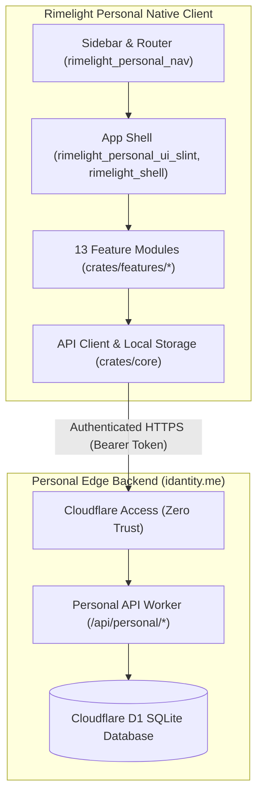

# Rimelight Personal — Project Specification

> **Status:** Single Source of Truth & Authoritative Technical Manual  
> **Project Name:** Rimelight Personal (formerly `rimelight-personal`)  
> **Primary Technology:** Rust 2024 (1.100.0) | Slint | Cloudflare D1 + Access | WebAssembly  
> **Backend Host:** set per instance with `RIMELIGHT_API_BASE` (see README.md). The current deployment is `idantity.me/api/personal` (Cloudflare Worker + D1), which moves out in R5.

---

## 1. High-Level Vision & Scope

**Rimelight Personal** is a native multiplatform personal productivity suite and life operating system built in Rust and Slint. It is the official native replacement for the legacy web app `personal.idantity.me`.

### Key Architectural Pillars

1. **Native Performance & Fluidity:** Replaces client-side web rendering with a high-performance native desktop client (Windows, macOS, Linux) and WebAssembly target powered by **Slint**.
2. **Unified Life Dashboard:** Aggregates 13 distinct life domains (tasks, calendar, finances, notes, health, housing, habits, and media) into a unified personal workstation.
3. **Edge Database & Serverless Sync:** Connects to Cloudflare D1 via the personal backend at `idantity.me/api/personal`, authenticated securely through Cloudflare Access.
4. **Shared Rimelight Design Tokens:** Employs `rimelight_design` tokens and `rimelight_shell` layouts to maintain visual harmony with Rimelight Space and the web ecosystem.

---

## 2. Technical Architecture



### Core Technologies
- **Rust Toolchain:** Pinned to `1.100.0` via `rust-toolchain.toml` (2024 edition).
- **UI Framework:** Slint 1.18.1 compiled via `crates/rimelight_personal_ui_slint`.
- **Backend Host:** Hosted within `idantity.me` worker at `/api/personal/*` querying Cloudflare D1 SQLite database with Drizzle ORM migrations.
- **Authentication:** Cloudflare Access policy validation (`POLICY_AUD` and secret tokens).

---

## 3. Comprehensive Feature Catalog (13 Core Modules)

### 3.1 Overview (`/`)
* **Unified Command Center:** Dynamic hero dashboard bringing all active modules together.
* **Quick Task Input:** Instant task capture submitting to the daily todo queue.
* **Daily Agenda:** Filtered list of tasks due today with one-click completion toggles.
* **Financial Summary:** Liquid balances, monthly fixed bills total, active subscription counts, and debt ledger ("I owe" / "Owed to me").
* **Module Shortcuts:** Fast-action widgets for active fasting timers, workout logs, habits, and pinned notes.

### 3.2 Todos (`/todos`)
* **Task Management:** Full task creation with title, priority (low, medium, high, urgent), categories, and scheduled due dates.
* **Filter Views:** Dedicated views for Today, Upcoming, Completed, and Categorized tasks.
* **Batch Operations:** Multi-select toolbar supporting batch completion and deletion.

### 3.3 Focus (`/focus`)
* **Productivity Timer:** Pomodoro and interval focus timer with configurable work/break cycles.
* **Ambient Audio:** Integrated background ambient noise player for deep work sessions.

### 3.4 Notes (`/notes`)
* **Organization:** Tabbed categorization (Active, Archived, Trash) with real-time text and tag search.
* **Rich Editor:** Debounced autosave, color coding, tag chip management, and quick note modals.
* **Pinned Notes:** Dedicated top tier for frequently referenced documentation.

### 3.5 Habits (`/habits`)
* **Calendar Mode:** 12-month visual grid tracking completion days across custom categories.
* **Streaks Mode:** 52-week activity heatmap (365 days) displaying current streaks, historical best streaks, and annual completion percentage.

### 3.6 Watchlist (`/watchlist`)
* **Media Catalog:** Tracking for Movies, TV Shows, Anime, and Books.
* **Statuses:** Categorized into Want to Watch/Read, In Progress, Completed, and Dropped.

### 3.7 Music (`/music`)
* **Audio Player:** Album drop zone, playlist queue, local audio playback, and metadata tags.

### 3.8 Notebooks (`/notebooks`)
* **Hierarchical Documentation:** Structured multi-page notebooks divided into volumes and chapters for deep writing.

### 3.9 Projects (`/projects`)
* **Kanban Boards:** Customizable columns, drag-and-drop card movements, task checklists, and sprint tracking.

### 3.10 Finances (`/finances`)
* **Accounting:** Multi-account balances (checking, savings, investments), transaction logs, income vs expenses breakdown.
* **Currency Support:** Primary tracking in BRL with automatic exchange rate conversion via Frankfurter API.
* **Recurring Obligations:** Scheduled bill reminders and active subscription renewals.

### 3.11 Housing (`/housing`)
* **Household Inventory:** Grocery lists, out-of-stock alerts, household supplies tracking.
* **Home Maintenance:** Recurring chore schedules, appliance warranties, and home repair logs.

### 3.12 Health (`/health`)
* **Biometrics:** Weight, body fat, and physical measurement logging over time with progress charts.
* **Intermittent Fasting:** Live fasting timer tracking hours elapsed and target fasting windows.
* **Workouts:** Routine templates and exercise set/rep/weight logging.

### 3.13 Inbox & Storage (`/inbox`, `/storage`)
* **Unified Communications:** Cloudflare Email Routing integration directing incoming emails (`daniel@`, `hello@`, `admin@`) into a triage inbox.
* **Cloud Storage Explorer:** File and document management with category tagging and file upload pipelines.

---

## 4. Workspace Layout & Crates

```
rimelight-personal/
├── apps/
│   ├── desktop/                 # Native Windows/desktop Slint entry point
│   └── web/                     # WebAssembly entry point
├── crates/
│   ├── core/                    # API client, SQLite offline cache, and domain types
│   ├── rimelight_personal_nav/            # Navigation model, route definitions, and sidebar state
│   ├── rimelight_personal_ui_slint/       # Slint compilation target and widget glue
│   └── features/                # 14 modular domain crates
│       ├── overview/            # Dashboard widgets
│       ├── todos/               # Task management logic
│       ├── focus/               # Timer and soundscapes
│       ├── notes/               # Notes editor and storage
│       ├── habits/              # Habit tracker and heatmaps
│       ├── watchlist/           # Media tracker
│       ├── music/               # Audio playback
│       ├── notebooks/           # Notebook document hierarchy
│       ├── projects/            # Kanban boards
│       ├── finances/            # Financial ledgers and rates
│       ├── housing/             # Chores and groceries
│       ├── health/              # Fasting and workouts
│       ├── inbox/               # Email triage
│       └── storage/             # Cloud storage client
├── AGENTS.md                    # Agent operating rules & "build once" constraint
├── README.md                    # Local development quickstart
└── PROJECT.md                   # Comprehensive technical manual & feature specs (this file)
```

---

## 5. Development Standards & Conventions

1. **Slint Isolation:** Slint markup compiles exclusively inside `crates/rimelight_personal_ui_slint` and feature crates. Components must adhere to tokens in `rimelight_design`.
2. **Build Discipline:** Adhere strictly to the "build ONCE at the end" rule. Write Rust feature logic across crates in batches before initiating cargo compilation.
3. **Zero Hardcoded Personal Secrets:** Email addresses and personal identities must be sourced dynamically from authenticated session tokens (`locals.user.email`), never hardcoded in client source.

---

## Status

> **Current Milestone:** Open-source, self-hosted restructure (decided 2026-11-24), alongside the remaining feature porting.  
> **Target Alignment:** Mirrors the modules defined in PROJECT.md. PROJECT.md, README.md and AGENTS.md still describe the idantity.me backend and get rewritten in step R1.6.  
> **Status:** Plan drafted, nothing started. Build rule applies: every step below is written without building; one build and test pass runs at the end of each batch (AGENTS.md).

---

### 0. Product direction (owner decisions, 2026-11-24)

Rimelight Personal becomes an **open-source app anyone can run on their own Cloudflare account**. You download the app, connect a Cloudflare account, the app sets up the backend there (Worker, D1, R2, Durable Objects, optional mail), and you sign in with Cloudflare Access. All data stays in the user's own account; nothing goes through Rimelight or idantity.me.

| Decision | Detail |
|---|---|
| Open source | The repository becomes public. Today it is the private `idantitydotme/rimelight-personal`; it moves to a public repo (name in Q1). Its git dependencies `rimelight-rs` and `rimelight` are already public (MIT). |
| One install per person | One Cloudflare account / one backend serves one person. No households or shared data. The `userId` column stays, set to the Access identity. |
| Separate from Rimelight Space | Space's notes, tasks and calendar are for work; Personal is for private life. They may share components through `rimelight-rs`, but they are separate products and neither embeds the other. |
| Backend leaves idantity.me | `idantity.me/api/personal`, `PERSONAL_BLOB`, `MailboxDO` and the personal D1 tables are removed from idantity.me once the owner's data lives in their own instance (R5). idantity.me goes back to being only the public site and CMS. |
| Backend stays TypeScript | Hono + Drizzle on a Worker, like rimelight.com and idantity.me. Users never build it: CI builds it once per release and the app ships the bundle (R3). |
| App-driven deploy | The app provisions and updates the backend through the Cloudflare API (R3). No "Deploy to Cloudflare" button and no forked repo per user, so app and backend versions never drift apart. Manual `wrangler`/`cf deploy` stays documented for contributors. |
| Mail is own-domain only | The inbox handles addresses on a domain the user has on Cloudflare (Email Routing in, Email Service out). It is **not** a general Gmail/Outlook/IMAP client. The module is optional and hidden when no domain is set up. |
| Mobile in scope | Android and iOS targets, reusing Space's `apps/android` and `apps/ios` setup (R6). |

---

### 1. Target architecture

```
rimelight-personal/              (public repo)
├── apps/desktop, apps/web, apps/android, apps/ios
├── crates/
│   ├── core/                    API client, models, instance config, sign-in (renamed personal_core)
│   ├── provision/               NEW: Cloudflare API client that sets up and updates a user's backend
│   ├── nav/, ui_slint/          (renamed from rimelight_personal_nav, rimelight_personal_ui_slint)
│   └── features/*               feature crates (renamed personal_feature_*)
├── worker/                      NEW: the TypeScript backend (Hono + Drizzle), moved out of idantity.me
│   ├── src/                     routes, Access check, MailboxDO, email handler
│   ├── drizzle/                 migrations, applied by the app on deploy/update
│   └── schema/                  generated JSON Schema for the API (shared types, R1.4)
└── tools/                       release scripts: build worker bundle, regenerate shared types
```

**Setup flow (first run):**
1. Welcome screen: "Connect your Cloudflare account" (or "I already have a backend": enter its URL).
2. The app opens Cloudflare's API-token page with the needed permissions prefilled. The user creates the token and pastes it into the app.
3. The app picks the account, then creates or reuses: the D1 database, the R2 bucket, the Worker (the bundle shipped in the app) with its bindings and Durable Object migration, the `workers.dev` route, D1 migrations, and the Access application and policy (allow the user's email).
4. The app stores the instance config (API base URL, Access team domain, Access AUD) and signs in through the existing cloudflared-style Access flow.
5. Optional later step: "Set up mail" (R4).

**Updates:** each app release carries the matching Worker bundle and migrations. On start the app reads `GET /meta` (backend version, schema version, configured modules). If the backend is older, the app redeploys it with the stored token, or asks for a token again if none is kept (Q4). There is no compatibility layer between versions: the app and its backend always move together.

---

### 2. Shared types between the Rust app and the TypeScript worker

Today `crates/core` hand-writes Rust structs (`Todo`, `Note`, `FinanceData`, …) that must match the JSON the TypeScript routes return. Nothing checks that they agree; a renamed column breaks the app only at run time.

**Chosen direction:** the worker is the source of truth.
- Every route declares its request and response shapes as zod schemas (most inputs already use zod; responses currently come straight from Drizzle rows and need schemas).
- A script exports them with zod 4's `z.toJSONSchema()` into `worker/schema/*.json`, checked in.
- The Rust types are generated from those files (for example with the `typify` crate, or a small generator in `tools/`), checked in, never hand-edited.
- CI regenerates both and fails if the checked-in files differ, so a server change that breaks the app fails CI instead of failing for users.

Fallback if generation proves awkward: keep hand-written Rust types and add contract tests that decode recorded worker responses (fixtures produced by the worker's own tests). Decide in R1.4.

---

### 3. Workstreams

Steps are batch-sized. Within a batch nothing is built; the batch ends with one build and test pass and a commit.

#### R0. Spikes and open decisions (before R3)
- R0.1 Cloudflare API spike (by hand, against a scratch account): can the API do every setup step? Specifically: create the Zero Trust organization (Cloudflare's setup asks for a plan choice and payment details even on the free plan, possibly dashboard-only), create the Access application + policy, enable the `workers.dev` route, upload a Worker with D1/R2/DO bindings and a DO migration, run D1 migrations. Record which steps need the dashboard; those become guided steps in the wizard.
- R0.2 Confirm the prefilled API-token link format and the minimum permission set (Workers Scripts, D1, R2, Access apps/policies, Workers routes, account read; Email Routing for R4).
- R0.3 Find where the owner's live data is today: the personal.idantity.me D1 database or idantity.me's. `idantity.me/docs/personal-backend-move.md` says nothing was migrated or deployed; this PLAN's old checklist said it was. Settle this before R5.
- R0.4 Answer the open questions in section 4.

#### R1. Repository and backend restructure
- R1.1 Move the personal backend into `worker/`: from `WebstormProjects/idantity.me` take the personal routes (`src/api/routes/*` except `contact.ts`), `src/api/lib/{auth,auth.logic,owned.logic}`, `src/db/schema/*`, `src/lib/currency.ts`, `src/tasks/cleanup.ts`, `src/workers/inbox/**`, the `email` handler and `MailboxDO` export, and `drizzle/0001_personal_backend.sql` (becomes `0000`). Mount routes at `/api/*` (the Worker is the whole host now), drop the `/api/personal/v1` rewrite, and keep the server bug fixes listed in that doc.
- R1.2 Remove owner-specific config: `PERSONAL_OWNER_ID` becomes the Access identity's stable id from the verified JWT; `EMAIL_ADDRESSES`, `DOMAINS`, `SITE_NAME`, `TEAM_DOMAIN`, `POLICY_AUD` become values the app sets at deploy time; drop `CONSTRUCTION_*`, `IMAGES` and `CLOUDFLARE_API_TOKEN` unless a route needs them.
- R1.3 Add `GET /meta`: backend version, schema version, which optional modules are configured (mail domain, R2).
- R1.4 Shared types (section 2): response schemas, JSON Schema export, Rust generation, CI drift check.
- R1.5 Rename: crates `rimelight_personal_*` to `personal_*`, keyring service `idantity` to `rimelight-personal`, license from `LicenseRef-Idantity-Proprietary` to the chosen open-source license (Q2), test fixtures from `daniel@example.com` to `example.com` addresses.
- R1.6 Rewrite README.md, PROJECT.md and AGENTS.md for the new architecture (self-hosted, `worker/`, setup flow), including contributor instructions for a manual `cf deploy`.
- R1.7 Before the repo goes public: audit the whole git history for secrets and personal data (tokens, `.dev.vars`, real emails, D1 ids, screenshots with personal data). Rewrite history or start a fresh public repo if anything is found (Q1). Add CONTRIBUTING, issue templates, and CI pinned to commit SHAs (org rule).

#### R2. Instance config and generic settings in the app
- R2.1 Replace the constants in `core/src/api.rs` and `core/src/auth.rs` (`DEFAULT_API_BASE`, `APP_ORIGIN`, `ACCESS_APP_URL`, `ACCESS_AUD`, `ACCESS_TEAM_ORIGIN`) with an `InstanceConfig` loaded from local storage, filled by the setup flow or entered by hand. The desktop `--api` flag sets it for development.
- R2.2 The web build reads its config from the Worker that serves it (same origin, `CF_Authorization` cookie, as today).
- R2.3 User settings stored in the backend: base currency (today BRL is built into `finance.rs`'s `convert_to_brl`), locale, date/week start, enabled modules.
- R2.4 Modules the backend reports as not configured (`/meta`) are hidden from the sidebar, with a "Set up" entry in settings.

#### R3. App-driven provisioning (`crates/provision`)
- R3.1 Cloudflare API client in Rust: accounts, D1 (create, query for migrations), R2 (create bucket), Workers (multipart upload with bindings and DO migrations, `workers.dev` route), Access (application, policy). Every step is idempotent: re-running setup finds and reuses what exists.
- R3.2 Release pipeline: CI builds `worker/` once and the app embeds the bundle and migrations (`include_bytes!`), so app version = backend version.
- R3.3 Setup wizard screens in Slint: welcome, token, account pick, progress per step with retry, guided dashboard steps found in R0.1, done.
- R3.4 Update path: version check against `/meta` on start; redeploy and migrate; clear error and "reconnect Cloudflare" if no token is stored.
- R3.5 Token handling per Q4: keep it in secure storage for updates, or discard after setup and ask again at each backend update.
- R3.6 Uninstall: "Remove backend" deletes the Worker and Access app, and optionally the D1 database and R2 bucket after an export (R5.1) and a typed confirmation.

#### R4. Mail module (optional, own domain only)
- R4.1 Wizard step "Set up mail": pick a domain already on the user's Cloudflare account, enable Email Routing, add a catch-all or per-address rule that sends to the Worker, onboard the domain for Email Service sending.
- R4.2 Addresses and mailboxes come from settings (today `EMAIL_ADDRESSES` in the worker config and `daniel@`/`hello@`/`admin@` in docs).
- R4.3 Users without a domain on Cloudflare never see the module.

#### R5. Data ownership and idantity.me retirement
- R5.1 Export and import: one archive with every D1 table as JSON plus the R2 files; import into an empty instance. Available from settings.
- R5.2 Move the owner's data: export from wherever R0.3 found it, set up a fresh instance on the owner's Cloudflare account through the normal setup flow, import. Keep R2 object keys so `cdn.idantity.me` links in old notes keep working, or rewrite them during import (Q5).
- R5.3 Remove `/api/personal`, `PERSONAL_BLOB`, `MailboxDO`, the email handler and the personal tables from idantity.me; remove the Access application for that path.
- R5.4 Retirement audit of `personal.idantity.me` (every file mapped to its new home or dropped on purpose), then the owner deletes it.

#### R6. Mobile
- R6.1 `apps/android` and `apps/ios`, copied from Space's setup and adapted.
- R6.2 Secure storage for the Access token and the Cloudflare API token on mobile (the `keyring` crate in `core/Cargo.toml` covers Windows, macOS and Linux only; Android needs Keystore, iOS Keychain).
- R6.3 Sign-in and the provisioning wizard through the system browser; narrow-screen layouts for every page.

#### R7. Feature work (continues alongside)
- R7.1 Finish the porting matrix in section 5.
- R7.2 New Calendar module (personal events; scope in Q6).

---

### 4. Open questions

| # | Question | Notes |
|---|---|---|
| Q1 | Public repo name and owner: `Rimelight-Entertainment/rimelight-personal`? Fresh repo or the current history? | A fresh repo is the simplest way to be sure no personal data from the private history goes public. |
| Q2 | Which open-source license? | `rimelight-rs` and `rimelight` are MIT. MIT keeps it consistent; AGPL would stop closed hosted forks. FFmpeg (used through `rimelight_media`) brings LGPL/GPL obligations to the shipped binaries either way. |
| Q3 | App name for other people: "Rimelight Personal"? | Store listings, Access app name, Worker name (`rimelight-personal`). |
| Q4 | Keep the Cloudflare API token after setup for automatic backend updates, or ask for it at each update? | Keeping it is smoother; it is a broad token on the user's device. |
| Q5 | Old R2 links (`cdn.idantity.me/...`) in the owner's notes: keep the custom domain on the new bucket, or rewrite links on import? | Only affects the owner's own data. |
| Q6 | Calendar scope: personal events only, or also subscribing to ICS feeds (holidays, a work calendar)? | Two-way Google/Microsoft sync would be a much larger project, like general mail. |
| Q7 | Music module: which parts need the backend (R2 uploads) versus local files only? | Affects what the module needs in setup. |

---

### 5. Page-by-Page Porting Status Matrix

| # | Module | Route | Web Parity Status | Native Implementation Notes |
|---|---|---|---|---|
| **1** | **Overview** | `/` | ✅ Ported | Checked against `DashboardOverview.tsx`: all four tiles, task preview with quick add and tick-off, pinned notes, and every navigation link. |
| **2** | **Todos** | `/todos` | ✅ Ported | Checked against `TodosManager.tsx`: six filter tabs, search, recurring fields in the add form, batch complete and delete (one request per todo, since the server has no batch action). |
| **3** | **Focus** | `/focus` | ✅ Ported | Checked against `common/FocusTimer.tsx`: work and break cycle, long break every fourth session, 880 Hz cue, reset, sessions count. Native adds the stretch routine and metronome. Audio goes through `rimelight_sound`; not yet heard on a real device. |
| **4** | **Notes** | `/notes` | ✅ Ported | Complete parity: active/archive/trash tabs, debounced autosave, tags, colors, and search. |
| **5** | **Habits** | `/habits` | ✅ Ported | Checked against `habits/HabitsTracker.tsx`: year tabs and add year, month grid and streaks view, 52-week grid, current and best streaks, category add and delete. |
| **6** | **Watchlist** | `/watchlist` | ✅ Ported | Checked against `watchlist/WatchlistManager.tsx`: add, edit, quick status change, tick-off, delete, categories with confirmation. Native adds sorting, search, multi-select and CSV export. |
| **7** | **Music** | `/music` | ✅ Ported | Checked against `music/*`: repertoire pieces with attachments and status, exercise checklists, metronome with tap tempo and subdivisions. |
| **8** | **Notebooks** | `/notebooks` | ✅ Ported | Checked against `notebooks/*`: create notebooks, entries add/edit/delete, pin, archive, trash and restore, rename. |
| **9** | **Projects** | `/projects` | ✅ Ported | Checked against `projects/KanbanBoard.tsx`: create board with the same four default lists, create list, add card, move card, delete card. |
| **10**| **Finances** | `/finances` | ✅ Ported | Checked against `finances/tabs/*` and the add modals: accounts, transactions, incomes, bills, budgets, debts, wishlist, each with its form, edit and delete. FX via Frankfurter. |
| **11**| **Housing** | `/housing` | ✅ Ported | Checked against `housing/*` and `groceries/*`: pets with history and weight entries, wishlist, grocery list. The web has no maintenance schedules, so none are needed. |
| **12**| **Health** | `/health` | ✅ Ported | Checked against `health/*`: fasting with protocols and custom hours, measurements with chart, goals and metrics, workouts with exercises, sets, stretches and the routine. |
| **13**| **Inbox** | `/inbox` | ✅ Ported (on paper) | Checked against `inbox/*`: compose, reply, forward, send, search, move between folders, attachments. Not yet exercised against live mail. |
| **14**| **Storage** | `/storage` | ✅ Ported | Checked against `storage/*`: upload, folders, move, rename, delete single and batch, copy link, previews, audio. |

---

### 6. Decision Log & Pending Resolutions (from PENDING_DECISIONS)

| Key | Topic | Proposed Direction | Status |
|---|---|---|---|
| **A** | **Color Palette Alignment** | Harmonize note/tag colors with `@rimelight/design` token values instead of custom hex. | ✅ Decided |
| **B** | **Batch Creation Bug** | Fix server-side batch handler so empty titles default cleanly without creating dummy records. | 🟨 In Progress |
| **C** | **Sidebar Dimensions** | Pinned to 240px expanded and 56px collapsed width, matching `rimelight_shell`. | ✅ Decided |
| **D** | **Currency Fallback** | Use Frankfurter API client in Rust core when live server rates are unreachable. | ✅ Decided |
| **E** | **Auth Fallback Removal** | Completely eliminate hardcoded user email fallbacks; require valid Cloudflare Access bearer token. | ✅ Decided |

---

### 7. Legacy Web App (`personal.idantity.me`) Retirement Checklist

Revised 2026-11-24: the backend no longer stays on idantity.me. The earlier checks below described the move into idantity.me; R0.3 confirms what actually happened.

- [ ] Where the live data is today confirmed (R0.3). Earlier claims, unverified: backend moved to `idantity.me/api/personal/*`; D1 migration `0001_personal_backend` applied with historical data; Access application created for that path.
- [ ] Backend lives in this repo's `worker/` and deploys to the owner's own instance through the app (R1, R3).
- [ ] Owner's data exported and imported into that instance (R5.2).
- [ ] Feature parity verified across all modules in `apps/desktop`.
- [ ] Automated end-to-end smoke test: setup against a scratch Cloudflare account, sign-in, data persists, update redeploys.
- [ ] Personal API, bindings and Access app removed from idantity.me (R5.3).
- [ ] Retirement audit done, then `personal.idantity.me` deleted by the owner (R5.4).
